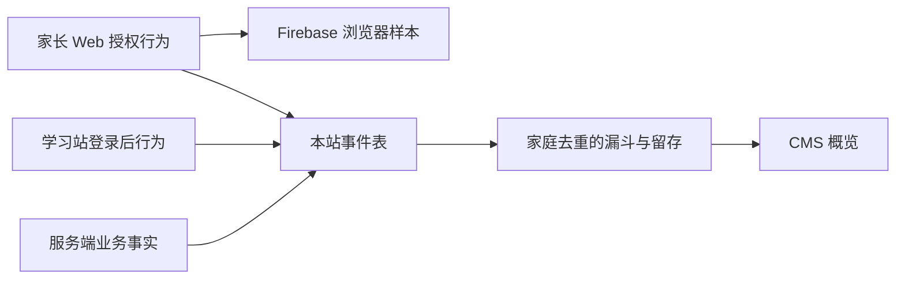

# 运营漏斗与事件口径

## 数据来源与采集策略

2026-10-26 新增服务端和学习站统计。按本次产品决策：**服务端业务统计、学习站行为统计不设同意门槛；只有家长 Web 行为统计需要用户同意**。

- 家长 Web：沿用 Firebase 同意机制，同时将已登录、已同意的订阅页面和结账事件写入本站事件表，关联家庭。未登录访问仍只在同意后的 Firebase 浏览器样本内分析，不尝试匹配家庭。
- 学习站：已登录即向本站 `/browser/student/events` 上报固定操作事件，无授权弹窗，不接入 Firebase，不创建额外持久浏览器标识。登录前的访问/连接失败不进入家庭行为漏斗。
- 服务端：在注册、绑定、问题处理、支付核验等业务路径记录事实，与家长 Web 是否同意无关。服务端不调用 Firebase Measurement Protocol，也不把家庭/学生 ID 发往 Google。
- 运营后台：概览 → **运营漏斗与学习留存**。超级管理员和管理员可查询；客服不能访问。也可通过带管理员 Bearer 凭据的 `GET /admin/analytics/funnels?start=2026-10-01&end=2026-10-26` 获取 JSON。

本站事件包含内部 `family_id`、必要时的 `student_id`，这是可关联的内部业务统计，**不宣称匿名数据**。不记录昵称、邮箱、手机号、原始 URL/query/hash、绑定码、设备安装标识、支付平台引用、问题正文、回答正文或学习评估内容。属性仅允许固定枚举及有限范围的名额数。浏览器不能自行指定家庭或学生身份，不能提交服务端事实事件；服务端从有效会话推导身份，并校验 Origin、CSRF、角色、事件白名单及参数白名单，每主体每分钟最多 60 个浏览器事件。采集失败不阻塞 Web 操作；不排队补发离线行为。

## 漏斗

所有查询以**UTC 注册日期**选取家庭 cohort，起止日均包含，最多连续 31 天。每个家庭在每一步至多计算一次，必须按顺序完成；重复刷新、重复问题、恢复购买不会抬高家庭数。每条漏斗独立选择成熟家庭，返回相邻转化率、累计转化率和待观察家庭数；零分母返回 `null`，CMS 显示 `—`。**只展示成熟样本的最终转化率**，尚未成熟样本不会按失败计入。

| 指标 | 路径 | 观察窗与分母 | 运营用途 |
|---|---|---|---|
| 激活 | 注册 → 设备绑定 → 服务端收到问题 → 有效学习完成 | 注册起 7×24 小时；全部已满 7 天的注册家庭 | 找出绑定或首次有效学习流失 |
| 学习站体验 | 进入学习站 → 提交问题 → 浏览器收到回答 | cohort 内首次进入学习站起 7×24 小时；已登录并满 7 天的进入家庭 | 衡量页面操作与回答送达；涵盖学习站，无同意筛选 |
| 结账转化 | 查看订阅 → 发起结账 → 服务端核验正价付款 | cohort 内首次授权订阅浏览起 30×24 小时；已满 30 天的浏览家庭 | 判断家长页面/结账流失，仅限授权样本 |
| 30 天转付费 | 注册 → 服务端核验正价付款 | 注册起 30×24 小时；全部已满 30 天的注册家庭 | 衡量注册后的正价付费；不强制先学习，允许用户直接购买 |
| 订阅激活 | 注册 → 核验订阅权益激活 | 注册起 30×24 小时；全部已满 30 天的注册家庭 | 包含金额证据缺失的平台；与付费指标对照判断核验覆盖 |
| D1/D7/D30 学习留存 | 首次有效学习 → 对应 UTC 自然日再次有效学习 | cohort 中注册后 30 天内首次有效学习的家庭；目标自然日必须已完整结束 | 判断学习习惯；不是滚动留存或“打开页面”留存 |

30 天转付费是固定观察窗，不等同于动态试用到期：后台试用天数发生变化时，不能把此指标直接称为“到期试用转化率”。结账与学习站漏斗中的一次发问、查看或点击并不证明真实业务成功，最终业务事实以服务端为准。学习站收到拒绝引导也会记录 `answer_received`，因此它只能表示页面收到回复，不能替代有效学习。

默认排除审核家庭、已停用家庭、配置在三个支付测试账号名单内的家庭，并排除测试支付事件；选择“包含测试支付”会同时纳入测试名单家庭和测试支付，审核/停用家庭仍排除。不同漏斗的样本来源、成熟时间不同，不应直接将它们相除。留存以家庭计，兄弟姐妹的有效学习可使同一家庭留存；学生级留存可后续单独设计。

## 事件字典与去重

| 来源 | 事件 | 触发及去重口径 |
|---|---|---|
| 服务端 | `family_registered`、`trial_started` | 真正创建家庭；家庭 ID 各一次，返回登录不重复 |
| 服务端 | `child_created` | 家长 API 创建孩子成功，按学生去重；旧原生直接绑定创建的孩子可没有此事件，因此不作为激活必经步骤 |
| 服务端 | `device_connected` | 绑定码确实被消费并完成设备绑定，按绑定码内部行 ID 去重；换设备可新增事件，家庭漏斗仍只算一次 |
| 服务端 | `question_accepted` | 问题成功入库并占用配额；按用户消息去重，同一消息的重试不新增。**不代表安全审核放行** |
| 服务端 | `learning_completed` | 非流式安全复核完成；或流式最终安全复核后回复入库。拒绝、空回答、模型失败不计。按用户消息去重；不是浏览器收妥证明，也不证明学习效果 |
| 服务端 | `subscription_activated` | 已核验的有效订阅交易或已结算本地订单；按内部交易/订单去重；可能包含零价或金额未知权益，不等同于付款 |
| 服务端 | `payment_confirmed` | 正价且状态有效的已核验商店交易，或成功结算的正价微信/演示订单；按内部交易/订单去重，重复验单/恢复不会新增 |
| 服务端 | `entitlement_revoked` | 商店交易核验为撤销，按内部交易去重；不是完整退款账本 |
| 学习站 | `student_page_view` | 首次已登录页面和固定页面类别切换；不包含具体资源 ID |
| 学习站 | `guide_completed`、`teacher_selected` | 确认使用引导、成功选择老师；不上传老师身份 |
| 学习站 | `question_submitted` | 浏览器通过本地条件检查后发起问题请求；不包含正文或图片 |
| 学习站 | `answer_received`、`answer_failed`、`answer_cancelled` | 当前流收到 done、请求失败、主动终止；不逐 token 上报；重复尝试是多个操作事件 |
| 家长 Web | `page_view`、`view_subscription`、`begin_checkout`、`checkout_open/closed/error`、`subscription_verify/manage` | 与 Firebase 固定口径相同，但只将已登录且同意的样本关联到本站家庭 |

`analytics_events.key` 全局唯一，采用家庭前缀及内部事实 ID，数据库 `ON CONFLICT DO NOTHING` 保证重放去重。浏览器事件另使用随机 UUID，并按当前主体分域，事件时间由服务端接收时生成。事件表不保存支付平台交易号或购买令牌。流式答案可能已入库但浏览器未收到 done，故服务端完成数与浏览器收到数可以不同。

## 支付和财务边界

付款时间为**本站首次观察到有效证据的时间**，不是平台扣款/结算时间；历史交易恢复不会被伪造成历史订单时间。该版本不回填既有家庭，因此报表只涵盖埋点上线后的新注册 cohort。新家庭的首次付款可在之后核验时进入漏斗，核验延迟会影响时间归属。

Google 当前核验响应没有可靠实付金额，保留 `subscription_activated`，不生成 `payment_confirmed`。Apple 需要正价交易金额；Creem 使用已核验的实付金额；Paddle 当前仅为 Sandbox（其价格快照不是生产财务实付），微信使用验证通过的订单金额。Creem Test、Paddle Sandbox、Apple Sandbox、演示及测试名单均不能混入正式付款指标。

当前不提供净收入、MRR/ARR、LTV、自动续费率或退款率。商店交易、订单和退款/撤销账本仍是财务来源；`subscription_verify`、订阅有效、回跳、取消自动续订都不能被当作新付款或退款。相同家庭第二笔交易会保留独立事实，但家庭转付费仍只计算一次。需要财务报表时，应先补齐各平台实付、实际交易时间、币种和退款事实，再按币种计算，不能混算金额或将此漏斗当作到账收入。

## 上线与维护

- 迁移 `2e5f7a9b1c3d` 仅增加 `analytics_events` 和查询索引；不对历史数据推测/补造事件。
- 先迁移及发布服务端，再发布 Web 与 CMS；采集仍在本站内，不需要新的 Firebase App、管理员私钥或 Measurement Protocol secret，也无需放宽学习站 CSP。
- 同步家长/学习站完整隐私政策中第一方业务与操作统计说明，并区分 Firebase 家长授权统计。2026-10-26 已随 `13b2537` 配套发布服务端、Web、CMS 和国际官网七语政策，生产 PostgreSQL 写入/去重/报表探针通过后回滚测试数据。
- 家庭完成删除时清除其全部运营事件；后续旧支付通知不会重新生成停用家庭的运营事件。报表因此会随删除变化，不能视为不可变财务历史。
- 当前事件保存在业务库内，沿用数据库访问、备份及清理管理；没有新增自动导出、外部分析仓库或后台清理任务。增长后将报表迁至只读分析副本/按日聚合，先保留家庭首次事实和活动日，再确定原始行为事件保留期限，避免清理后把历史缺失误算成流失。
- 验证：服务端 `tests/test_operations_analytics.py` 覆盖身份/CSRF、事件白名单、幂等、重试、付款证据、成熟分母、顺序、UTC 留存、测试分离及权限；Web 家庭端到端流程校验学习站无同意弹窗、仅本站发送且不包含内容；原 Firebase 同意/撤回测试继续保留。
